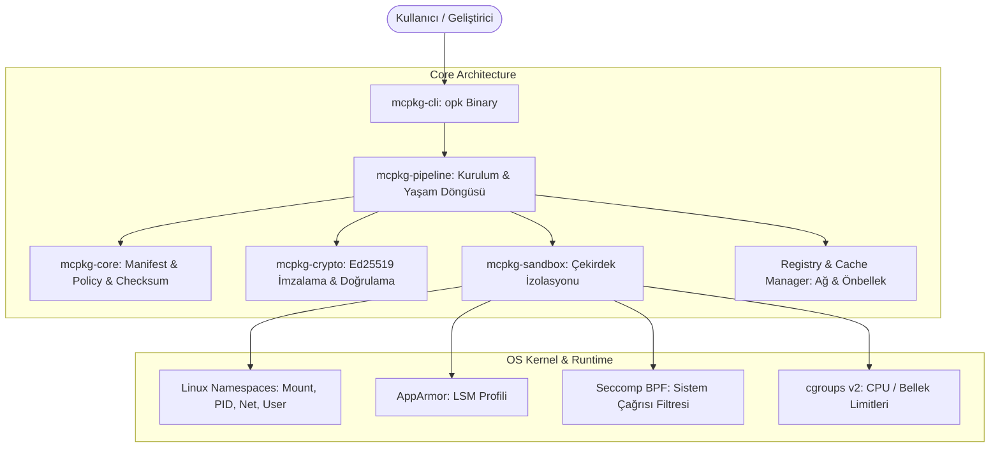
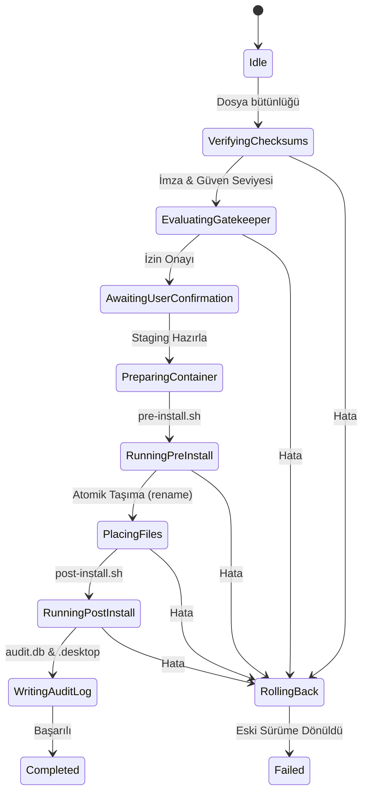

# Sistem Mimarisi — Orion Package Kit (`opk`)

> **Versiyon:** 1.0.0  
> **Hedef Sistem:** Orion OS (Linux 6.x+, cgroups v2, AppArmor)  
> **Dil & Araç:** Rust 2024 Workspace  
> **Konum:** `docs/ARCHITECTURE.md`

---

## 1. Genel Mimari Bakış

`opk` (Orion Package Kit), mobil ve gömülü Linux cihazlar için tasarlanmış modüler, güvenlik odaklı (sandbox-first) ve atomik güncelleme desteğine sahip yeni nesil bir paket yönetim sistemidir. 

Paket yöneticisi monolitik bir yapı yerine bağımsız ve tek sorumluluk prensibine (Single Responsibility) göre ayrılmış 5 ana Rust crate'inden meydana gelir:



---

## 2. Modül (Crate) Sorumlulukları

| Modül | Sorumluluk Alanı | Temel Bağımlılıklar |
|---|---|---|
| **`mcpkg-core`** | `manifest.toml` ve `sandbox.policy` ayrıştırma, dosya SHA-256 sağlama toplamı hesaplama. | `toml`, `serde`, `sha2`, `hex` |
| **`mcpkg-crypto`** | Ed25519 anahtar çifti üretimi, paket imzalama ve açık anahtar doğrulama. | `ed25519-dalek`, `rand` |
| **`mcpkg-sandbox`** | Linux Namespaces (`unshare`), rootless UID/GID eşleme, AppArmor profil oluşturma ve Seccomp filtreleri. | `nix`, `libseccomp` |
| **`mcpkg-pipeline`** | Atomik dosya taşıma, rollback, kurulum durum makinesi (`InstallState`), yaşam döngüsü ve registry istemcisi. | `zip`, `reqwest`, `tempfile` |
| **`mcpkg-cli`** | Kullanıcı ve geliştirici komut satırı arayüzü (`opk` ikilisi). | `clap`, `tokio` |

---

## 3. Katmanlı Güvenlik Modeli (Defense-in-Depth)

Orion OS üzerindeki her uygulama varsayılan olarak potansiyel olarak güvensiz kabul edilir ve 4 katmanlı bir izolasyon zırhı içerisinde çalıştırılır:

```
┌──────────────────────────────────────────────────────────────────┐
│  Uygulama Süreci (ELF Binary)                                    │
├──────────────────────────────────────────────────────────────────┤
│ 1. Seccomp BPF Filtresi                                           │
│    Tehlikeli çekirdek sistem çağrılarını (ptrace, kexec vb.)     │
│    ve izinsiz soket/IPC işlemlerini engeller.                   │
├──────────────────────────────────────────────────────────────────┤
│ 2. AppArmor Profili (LSM)                                         │
│    Dosya sistemi okuma/yazma ve ağ erişim izinlerini paket       │
│    politikasına göre zorunlu kılar.                              │
├──────────────────────────────────────────────────────────────────┤
│ 3. Linux Namespaces (Mount, PID, Net, User)                      │
│    Rootless kullanıcı alanı, izole dosya sistemi ve ağ görünümü. │
├──────────────────────────────────────────────────────────────────┤
│ 4. cgroups v2 Limitleri                                          │
│    Bellek tüketimi (memory.max) ve işlemciyi (cpu.max) sınırlar. │
└──────────────────────────────────────────────────────────────────┘
```

---

## 4. Kurulum ve Yaşam Döngüsü Durum Makinesi

Her kurulum işlemi atomik bir durum makinesi üzerinden yürütülür. Herhangi bir aşamada hata oluştuğunda sistem otomatik olarak önceki stabil durumuna geri döner (Rollback):



---

## 5. Dosya Sistemi ve Veri Depolama Mimarisi

* **Uygulama İkilileri:** `/opt/orion/apps/{package_id}/`
* **Kullanıcı Verileri (Dokunulmaz):** `~/.local/share/{package_id}/`
* **Yapılandırma Dosyaları:** `~/.config/{package_id}/`
* **Masaüstü Kısayolları:** `~/.local/share/applications/{package_id}.desktop`
* **Uygulama İkonları:** `~/.local/share/icons/orion/{package_id}.png`
* **Paket İndirme Önbelleği:** `~/.cache/orion/packages/{package_id}/{version}.opk`
* **Denetim Veritabanı:** `~/.local/share/orion/bekci/audit.db`
* **Kurulu Paket Veritabanı:** `/opt/orion/registry/installed.db`
