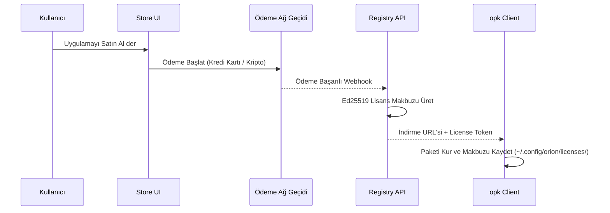

# Orion Store Ödeme ve Lisans Entegrasyonu (Payment Integration)

> **Konum:** `docs/PAYMENT_INTEGRATION.md`  
> **Kapsam:** Ücretli Uygulamalar, Abonelikler ve Geliştirici Gelir Paylaşımı

---

## 1. Genel Felsefe: Adil ve Kullanıcı Dostu

Orion ekosistemi, kullanıcı cihazını kilitleyen hantal DRM mekanizmalarına karşıdır. Ödeme ve lisanslama, açık kriptografik jetonlar (Cryptographic License Tokens) ve şeffaf API'ler üzerinden yürütülür:

* **Çevrimdışı Kullanım Hakkı:** Satın alınan bir uygulama çevrimdışı doğrulanabilir dijital makbuz (receipt token) ile çalışır.
* **Geliştirici Komisyon Oranı:** %88 geliştiriciye, %12 Orion ekosistem ve altyapı fonuna aktarılır.

---

## 2. `manifest.toml` Fiyatlandırma Şeması

Bir uygulamanın ücretli veya abonelikli olduğunu belirtmek için `[store]` bloğu yapılandırılır:

```toml
[store]
category    = "productivity"
rating      = "ALL"
tier        = "premium"         # free | standard | premium
price_usd   = 4.99              # Tek seferlik satın alma ücreti (0.00 = ücretsiz)

# İsteğe bağlı: Abonelik modeli
[store.subscription]
enabled         = true
price_monthly   = 1.99          # Aylık abonelik
price_yearly    = 19.99         # Yıllık indirimli abonelik
trial_days      = 14            # 14 günlük ücretsiz deneme süresi
```

---

## 3. Lisanslama ve Satın Alma Akışı



---

## 4. Uygulama İçi Lisans Doğrulama (In-App Verification)

Uygulama kendi içinde kullanıcının geçerli bir lisansa sahip olup olmadığını yerel makbuz üzerinden kontrol edebilir:

```rust
// Uygulama kodu içinde örnek kontrol:
let license_path = format!("{}/.config/orion/licenses/{}.token", home_dir, app_id);
if let Ok(token) = std::fs::read_to_string(license_path) {
    // Orion Store açık anahtarıyla imzayı doğrula
    if verify_store_signature(&token, &ORION_STORE_PUBLIC_KEY).is_ok() {
        println!("Lisans geçerli: Premium özellikler aktif.");
    }
}
```

---

## 5. İadeler ve İptaller

* **48 Saat Koşulsuz İade:** Kullanıcı satın alımdan sonraki 48 saat içinde tek tıkla iade talep edebilir.
* **Abonelik İptali:** İptal edilen abonelikler fatura dönemi sonuna kadar aktif kalmaya devam eder.
