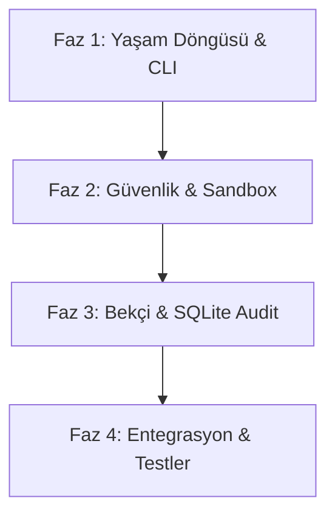

# Orion Package Kit (`opk`) — Geliştirme Yol Haritası ve Eksikler Raporu

> **Versiyon:** 1.0.0  
> **Tarih:** 2026-10-13  
> **Kapsam:** Tüm Crate'ler (`core`, `crypto`, `sandbox`, `pipeline`, `cli`)  
> **Durum:** Aktif Yol Haritası

---

## 1. Yönetici Özeti (Executive Summary)

`opk` (Orion Package Kit), Orion OS için tasarlanmış sandbox-öncelikli, kriptografik doğrulamalı ve atomik güncellemeli bir paket yöneticisidir.

Mevcut sistemde:
* ZIP arşivleme, Ed25519 imzalama/doğrulama, SHA-256 sağlama toplamları, temel indirme ve CLI komutları çalışır vaziyettedir.
* Ancak işletim sistemi seviyesinde eksiksiz ve güvenli bir paket yöneticisi olabilmesi için **kaldırma (`uninstall`), listeleme (`list`), güncelleme (`update`), SQLite denetim günlüğü (`audit.db`), cgroups v2 kaynak sınırlaması ve Seccomp BPF'in varsayılan olarak devreye alınması** gibi kritik bileşenlerin tamamlanması gerekmektedir.

---

## 2. Tespit Edilen Eksikler ve İyileştirme Alanları

### A. Yaşam Döngüsü ve CLI Eksiklikleri (Lifecycle Gaps)
1. **`opk uninstall <app_id>` Yok:** Kurulu paketleri kaldırma mekanizması bulunmuyor.
2. **`opk list` Yok:** Sistemde kurulu paketleri listeleyen ve durumunu izleyen komut yok.
3. **`opk info <id|opk>` Yok:** Paket metadata ve güvenlik politikasını hızlıca inceleme aracı yok.
4. **`opk update [id]` Yok:** Yeni sürümleri kontrol edip tek komutla güncelleyen yapı yok.
5. **`opk search <sorgu>` Yok:** Registry API üzerinde arama yapma istemcisi CLI'a bağlanmamış.

### B. Bekçi (Gatekeeper) & Audit Log Eksiklikleri
1. **SQLite Audit Log Yok:** Şartnamede geçen `~/.local/share/orion/bekci/audit.db` SQLite veritabanı kodu henüz yazılmamış (`rusqlite` eklenmeli).
2. **Politika Risk Puanlama Motoru Yok:** `sandbox.policy` içindeki izinlerin ağırlıklı puanlama (0-100) sistemi (`score_policy`) mevcut değil.
3. **Güven Seviyesi Ayrımı Yok:** `Verified` / `Signed` / `Unsigned` sınıflandırması sadece basit bir terminal uyarısı seviyesinde kalmış durumda.
4. **Etkileşimli İzin Onayı:** Kurulum anında kullanıcıya izinler gösterilip terminalde interaktif onay sorulmuyor.

### C. Güvenlik ve İzolasyon Eksiklikleri (Sandbox Gaps)
1. **Seccomp BPF Varsayılan Olarak Kapalı:** `mcpkg-sandbox` içinde `seccomp` özelliği `default = []` olduğu için derlemede kod no-op dönüyor. Varsayılan bağımlılık haline getirilmeli.
2. **cgroups v2 Entegrasyonu Yok:** CPU (`cpu.max`) ve RAM (`memory.max`) limitleri henüz çekirdeğe yazılmıyor.
3. **Mount İzolasyonu:** Yalnızca `mount --make-rprivate /` çağrılıyor; dizin düzeyinde bağlama ve kısıtlama adımları genişletilmeli.

### D. Sistem Entegrasyonu ve Dosya Yolları
1. **Kalıcı Dizin:** Uygulamaların `/tmp/orion/apps` yerine standart `/opt/orion/apps` (root) veya `~/.local/share/orion/apps` (rootless) dizinine kurulması.
2. **Desktop ve İkon:**
   - `.desktop` dosyasında launcher yolu `opk launch <app_id>` olarak düzeltilmeli.
   - Paketteki `assets/icon.png` taranıp `~/.local/share/icons/orion/` dizinine yerleştirilmeli.
3. **Çoklu Mimari:** Host mimarisi tespit edilerek `entry_x86_64` veya `entry_aarch64` çalıştırılmalı.
4. **Bağımlılık Denetimi:** `min_os`, `max_os` ve `dependencies` alanlarının kontrolü eklenmeli.

### E. İsimlendirme ve Kod Kalitesi
1. `mcsimon` ve `orion` terimlerinin tek bir standart altında (`orion`) birleştirilmesi.
2. `tempfile::TempDir::into_path` deprecation uyarısının `TempDir::keep()` ile düzeltilmesi.
3. `mcpkg-core`, `mcpkg-crypto` ve `mcpkg-cli` için birim testlerinin yazılması.

---

## 3. Öncelikli Geliştirme Fazları

### 🔹 Faz 1: Yaşam Döngüsü & Paket Yönetimi (Öncelik: P0)
* [ ] `installed.db` SQLite veya yerel kayıt defteri yapısının kurulması
* [ ] `opk uninstall` komutunun eklenmesi (dosya, masaüstü, profil temizliği)
* [ ] `opk list` komutunun eklenmesi (tablo ve JSON formatında)
* [ ] `opk info` komutunun eklenmesi
* [ ] `opk update` komutunun atomik güncelleme ile bağlanması
* [ ] Kurulum dizininin `/tmp` yerine kalıcı yola alınması

### 🔹 Faz 2: Güvenlik, Seccomp ve Sandbox Sertleştirme (Öncelik: P0)
* [ ] `mcpkg-sandbox` içinde `libseccomp` özelliğinin varsayılan (`default`) yapılması
* [ ] cgroups v2 yöneticisinin yazılması (`/sys/fs/cgroup/orion/apps/{id}`)
* [ ] Gelişmiş mount namespace ve dosya erişim kısıtlamaları
* [ ] Kurulum öncesi terminal izin onay ekranının (`[Y/n]`) eklenmesi

### 🔹 Faz 3: Bekçi (Gatekeeper) & SQLite Audit Log (Öncelik: P1)
* [ ] `audit.db` SQLite veritabanı motorunun entegre edilmesi
* [ ] Risk puanlama motorunun (`score_policy`) yazılması
* [ ] Güven seviyesi (`TrustLevel`) doğrulaması
* [ ] `opk audit` alt komutlarının eklenmesi

### 🔹 Faz 4: Sistem Entegrasyonu, Testler ve İyileştirmeler (Öncelik: P2)
* [ ] İkon kopyalama ve masaüstü launcher düzeltmesi
* [ ] Çoklu mimari tespiti (`x86_64` / `aarch64`)
* [ ] Registry anahtar zinciri (Keyring) çözümü
* [ ] `mcpkg-core` ve `mcpkg-crypto` birim testlerinin eklenmesi
* [ ] `mcsimon` -> `orion` isimlendirme temizliği
